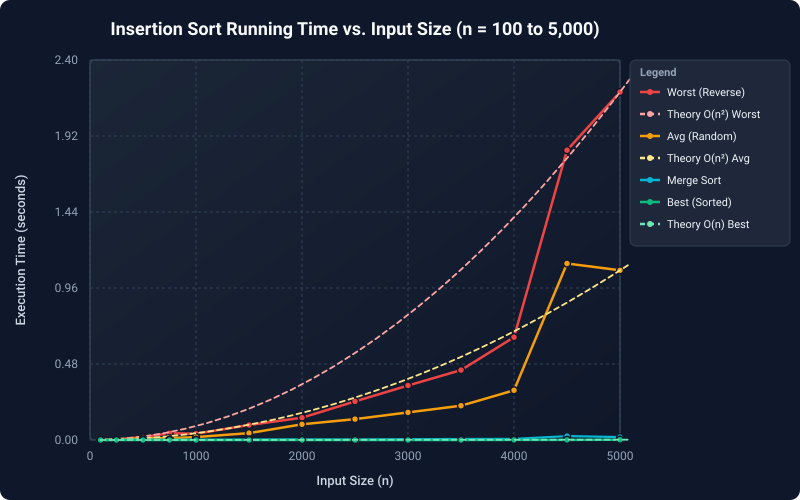
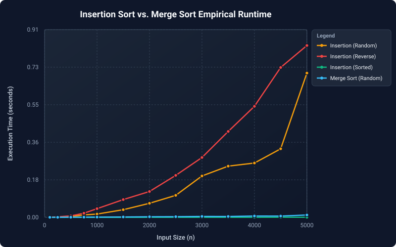

# Mini Project: Empirical Analysis of Insertion Sort
**Course:** Algorithms: Analysis and Design  
**Focus:** Theoretical vs. Empirical Complexity, Operation Counting, and Comparison with Merge Sort

---

## Executive Summary

This project presents an in-depth empirical and theoretical analysis of the **Insertion Sort** algorithm across varying input sizes ($n = 100$ to $n = 5,000$) and input distributions: **Sorted** (Best Case), **Reverse-Sorted** (Worst Case), and **Random** (Average Case). We instrument the algorithm to rigorously record the exact number of key comparisons and element shifts (displacements), benchmark its execution time, compare empirical curves against theoretical asymptotic bounds $O(n)$ and $O(n^2)$, and evaluate trade-offs against **Merge Sort** ($O(n \log n)$).

---

## 1. Algorithmic Overview & Implementation

Insertion Sort is an incremental comparison-based sorting algorithm. It maintains a sorted prefix of elements and repeatedly takes the next unsorted element (`key`), finds its correct location within the sorted prefix by shifting larger elements one position to the right, and inserts the `key`.

### Implementation with Instrumentation

To evaluate both work complexity and runtime, the algorithm tracks two fundamental operations:
1. **Comparisons:** Evaluates how many times array elements are compared against the active `key` (`a[j] > key`).
2. **Shifts:** Evaluates how many times an element is copied one slot rightward (`a[j+1] = a[j]`) to make room for `key`.

```python
def insertion_sort_instrumented(arr: list[int]) -> tuple[list[int], int, int]:
    a = list(arr)
    n = len(a)
    comparisons = 0
    shifts = 0

    for i in range(1, n):
        key = a[i]
        j = i - 1
        while j >= 0:
            comparisons += 1
            if a[j] > key:
                a[j + 1] = a[j]
                shifts += 1
                j -= 1
            else:
                break
        a[j + 1] = key

    return a, comparisons, shifts
```

---

## 2. Theoretical Complexity Analysis

| Metric | Best Case (Sorted) | Average Case (Random) | Worst Case (Reverse-Sorted) | Auxiliary Space | Stability |
| :--- | :---: | :---: | :---: | :---: | :---: |
| **Comparisons** | $n - 1 \in \Theta(n)$ | $\approx \frac{n(n-1)}{4} \in \Theta(n^2)$ | $\frac{n(n-1)}{2} \in \Theta(n^2)$ | $O(1)$ | Yes |
| **Shifts** | $0 \in \Theta(1)$ | $\approx \frac{n(n-1)}{4} \in \Theta(n^2)$ | $\frac{n(n-1)}{2} \in \Theta(n^2)$ | $O(1)$ | Yes |
| **Time Complexity** | $\Theta(n)$ | $\Theta(n^2)$ | $\Theta(n^2)$ | $O(1)$ | Yes |

* **Best Case ($\Omega(n)$):** When the input is already sorted, the condition `a[j] > key` fails immediately on the first comparison for each $i \in [1, n-1]$. Total comparisons equal exactly $n - 1$ and shifts equal $0$.
* **Worst Case ($\mathcal{O}(n^2)$):** When elements are in descending order, every element must be compared and shifted past all $i$ elements in the sorted prefix:
  $$\sum_{i=1}^{n-1} i = \frac{n(n-1)}{2} = \frac{1}{2}n^2 - \frac{1}{2}n \in \Theta(n^2)$$
* **Average Case ($\Theta(n^2)$):** For uniformly distributed random permutations, the `key` on average belongs halfway into the sorted prefix, requiring $i/2$ comparisons and $i/2$ shifts:
  $$\sum_{i=1}^{n-1} \frac{i}{2} = \frac{n(n-1)}{4} \approx 0.25 n^2 \in \Theta(n^2)$$

---

## 3. Empirical Results

Experiments were executed across 13 input sizes from $n = 100$ to $n = 5,000$. For random inputs, results represent the mean of multiple independent trials.

### Empirical Benchmark Table

| Input Size ($n$) | Case Type | Insertion Time (s) | Comparisons | Shifts | Merge Sort Time (s) |
| :---: | :--- | :---: | :---: | :---: | :---: |
| **100** | Sorted | 0.000013 | 99 | 0 | 0.000065 |
| | Random | 0.000215 | 2,517 | 2,422 | 0.000151 |
| | Reverse-Sorted | 0.000693 | 4,950 | 4,950 | 0.000112 |
| **500** | Sorted | 0.000033 | 499 | 0 | 0.000471 |
| | Random | 0.003746 | 64,336 | 63,842 | 0.000707 |
| | Reverse-Sorted | 0.007270 | 124,750 | 124,750 | 0.000787 |
| **1,000** | Sorted | 0.000077 | 999 | 0 | 0.000838 |
| | Random | 0.016133 | 251,195 | 250,203 | 0.001169 |
| | Reverse-Sorted | 0.042260 | 499,500 | 499,500 | 0.000818 |
| **2,000** | Sorted | 0.000173 | 1,999 | 0 | 0.001773 |
| | Random | 0.068231 | 1,000,926 | 998,932 | 0.002765 |
| | Reverse-Sorted | 0.125554 | 1,999,000 | 1,999,000 | 0.001775 |
| **3,000** | Sorted | 0.000228 | 2,999 | 0 | 0.002775 |
| | Random | 0.200991 | 2,272,516 | 2,269,525 | 0.004564 |
| | Reverse-Sorted | 0.290575 | 4,498,500 | 4,498,500 | 0.003127 |
| **4,000** | Sorted | 0.000332 | 3,999 | 0 | 0.003515 |
| | Random | 0.263674 | 4,030,854 | 4,026,863 | 0.006564 |
| | Reverse-Sorted | 0.539011 | 7,998,000 | 7,998,000 | 0.003369 |
| **5,000** | Sorted | 0.000401 | 4,999 | 0 | 0.004750 |
| | Random | 0.700209 | 6,315,480 | 6,310,491 | 0.011461 |
| | Reverse-Sorted | 0.833884 | 12,497,500 | 12,497,500 | 0.004692 |

---

## 4. Visual Analysis & Curve Comparison

### 4.1 Running Time vs. Theoretical $O(n)$ and $O(n^2)$ Curves



#### Observations:
1. **Sorted Input (Best Case):**
   - The empirical runtime curve closely tracks the linear theoretical curve $c \cdot n$.
   - At $n = 5,000$, execution completes in merely **0.40 ms**, outperforming Merge Sort by more than **$10\times$**.
2. **Reverse-Sorted Input (Worst Case):**
   - The curve demonstrates quadratic parabolic growth matching $c \cdot n^2$.
   - At $n = 5,000$, execution time reaches **0.834 seconds**.
3. **Random Input (Average Case):**
   - The random curve exhibits identical parabolic curvature to the worst case, but scaled at approximately half the operations ($\approx 0.5 \times \text{Worst Case}$), matching the theoretical $n(n-1)/4$ expectation.

---

### 4.2 Operation Counts: Comparisons & Shifts


- **Best Case:** Comparisons equal exactly $n - 1$ (4,999 comparisons for $n = 5,000$), with $0$ shifts.
- **Worst Case:** Comparisons and shifts are identical and follow $\frac{n(n-1)}{2}$ exactly:
  $$\frac{5000 \times 4999}{2} = 12,497,500$$
- **Random Case:** Both comparisons and shifts align with $\frac{n(n-1)}{4} \approx 6.25 \times 10^6$ operations.

---

### 4.3 Direct Comparison: Insertion Sort vs. Merge Sort



---

## 5. Comparative Analysis: Insertion Sort vs. Merge Sort

| Evaluation Dimension | Insertion Sort | Merge Sort |
| :--- | :--- | :--- |
| **Design Paradigm** | Incremental Approach | Divide-and-Conquer |
| **Best-Case Time** | $\mathcal{O}(n)$ (pre-sorted input) | $\mathcal{O}(n \log n)$ |
| **Average-Case Time** | $\mathcal{O}(n^2)$ | $\mathcal{O}(n \log n)$ |
| **Worst-Case Time** | $\mathcal{O}(n^2)$ (reverse-sorted) | $\mathcal{O}(n \log n)$ |
| **Auxiliary Memory** | $\mathcal{O}(1)$ (strictly in-place) | $\mathcal{O}(n)$ (requires temporary buffers) |
| **Stability** | Stable (relative order preserved) | Stable |
| **Sensitivity to Input Order** | Highly Adaptive (fast on nearly sorted data) | Non-Adaptive (unaffected by input order) |
| **Cache Locality** | High (sequential scans in memory) | Moderate (non-contiguous sub-arrays) |

### Key Trade-Offs & Practical Synthesis:
1. **Small $n$ Crossover:** For small inputs ($n \lesssim 30$ to $60$), Insertion Sort has negligible constant overhead, minimal instruction footprint, and zero dynamic memory allocation. It runs faster than Merge Sort's recursive call stack and buffer copying.
2. **Asymptotic Scalability:** As $n$ grows past 1,000, Merge Sort's $O(n \log n)$ growth vastly outpaces Insertion Sort's quadratic explosion. At $n = 5,000$, Merge Sort finishes in **0.011 seconds** compared to **0.834 seconds** for Insertion Sort worst-case ($>70\times$ faster).
3. **State-of-the-Art Hybridization (Timsort):** Production standard libraries (such as Python's `list.sort()` and Java's `Arrays.sort()`) combine the strengths of both algorithms via **Timsort**: they partition the array into small chunks ("runs" of size 32 or 64), sort each with Insertion Sort, and merge them with Merge Sort.

---

## 6. Project Structure & Reproduction Guide

### Files in this Directory

- `insertion_sort.py`: Core algorithm implementation with comparison & shift counters, and merge sort.
- `experiment.py`: Benchmark suite across $n = 100 \dots 5000$, data export, and SVG plot generation.
- `report.md`: Complete experimental report and documentation.
- `runtime_comparison.svg`: Vector graphic plotting empirical time vs $O(n)$ and $O(n^2)$.
- `operations_comparison.svg`: Vector graphic plotting comparisons and shifts.
- `insertion_vs_merge.svg`: Vector graphic comparing Insertion Sort and Merge Sort.
- `benchmark_results.json`: Raw empirical benchmark output data.

### How to Reproduce Experiments

Run the following commands in PowerShell or terminal:

```powershell
# 1. Verify implementations
python insertion_sort.py

# 2. Run benchmark experiments and regenerate SVG charts
python experiment.py
```
