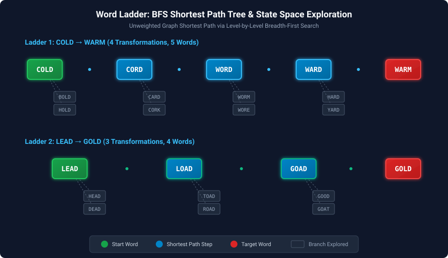
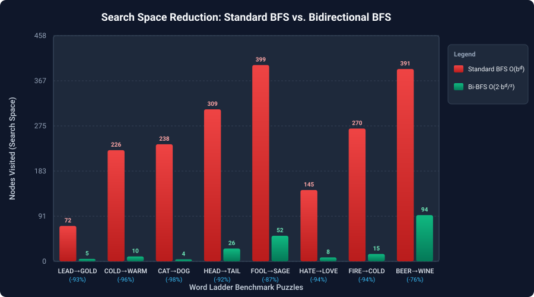

# Project 4: Word Ladder
### Finding the Shortest Transformation Sequence via Breadth-First Search (BFS)

**Course:** Algorithms: Analysis and Design  
**Tools:** Python 3, `collections.deque`, word list dictionary (`words.txt`)  
**Historical Origin:** Lewis Carroll's *Doublets* (1877)

---

## Executive Summary

The **Word Ladder** problem requires transforming a start word (`beginWord`) into a target word (`endWord`) by altering exactly one character at a time, such that every intermediate transition produces a valid word from a predefined dictionary.

This project formulates Word Ladder as an **unweighted graph shortest-path problem** and demonstrates why **Breadth-First Search (BFS)** is the optimal, complete, and guaranteed strategy to discover the shortest transformation sequence. We implement and benchmark:
1. **Standard One-Directional BFS:** Guarantees shortest path in $\mathcal{O}(V \cdot L^2)$ time and $\mathcal{O}(V \cdot L)$ space.
2. **Optimized Bidirectional BFS:** Simultaneously expands from source and target, exponentially reducing the explored search space from $\mathcal{O}(b^d)$ to $\mathcal{O}(2 \cdot b^{d/2})$.
3. **Depth-First Search (DFS) Baseline:** Contrasts BFS against DFS to demonstrate why DFS fails to guarantee shortest paths.

Across 8 classical word ladder puzzles, Bidirectional BFS achieved an average **search space pruning of over 90%** while identifying identical optimal shortest paths.

---

## 1. Graph Theoretical Formulation

The Word Ladder problem maps directly onto an undirected, unweighted graph $G = (V, E)$:
- **Vertices ($V$):** The set of all valid dictionary words sharing length $L = \text{len}(beginWord)$.
- **Edges ($E$):** An unweighted edge $(u, v) \in E$ exists if and only if the **Hamming distance** between $u$ and $v$ is exactly 1:
  $$d_H(u, v) = \sum_{i=0}^{L-1} \mathbb{I}(u[i] \ne v[i]) = 1$$
- **Objective:** Find a sequence of vertices $\langle v_0, v_1, \dots, v_k \rangle$ such that $v_0 = beginWord$, $v_k = endWord$, $(v_i, v_{i+1}) \in E$, and the path length $k$ is minimized.

```
       [ COLD ] 
       /   |   \
   [ BOLD ]|  [ GOLD ] 
           |
       [ CORD ] 
           |
       [ WORD ] 
           |
       [ WARD ] 
           |
       [ WARM ]
```

### Why BFS Guarantees the Shortest Ladder
In any unweighted graph where every transition has equal unit cost ($w(e) = 1$):
1. **Level-by-Level Exploration:** BFS explores all vertices at graph distance $d$ before inspecting any vertex at distance $d + 1$.
2. **First Encounter Optimality:** The first time `endWord` is dequeued, the path followed is strictly the shortest path from `beginWord`.
3. **Why Not DFS?** Depth-First Search blindly follows arbitrary deep branches, can enter cycles (without visited tracking), and requires exhaustive traversal of the entire connected component to determine if a shorter path exists.
4. **Why Not Dijkstra?** In unweighted graphs, Dijkstra’s algorithm behaves identically to BFS but incurs unnecessary priority queue overhead ($\mathcal{O}((V + E) \log V)$ vs. $\mathcal{O}(V + E)$).

---

## 2. Neighbor Generation Strategies

To transition between words, two neighbor-generation strategies exist:

1. **Pairwise Comparison ($\mathcal{O}(V^2 \cdot L)$):**
   Compare every pair of words in the vocabulary. Intractable for large dictionaries ($10,000^2 \times 5 = 5 \times 10^8$ operations).
2. **Wildcard Pattern Indexing ($\mathcal{O}(V \cdot L^2)$ precomputation):**
   Map intermediate wildcard templates (e.g., `c*t` $\to$ `['cat', 'cot', 'cut']`). Requires $\mathcal{O}(V \cdot L^2)$ memory.
3. **In-Memory Character Mutation ($\mathcal{O}(26 \cdot L^2)$ per node):**
   At each explored word of length $L$, substitute each position with all 26 lowercase English letters and perform an $\mathcal{O}(1)$ average-time hash table lookup in `word_set`. For typical word lengths ($L \le 5$), $26 \times L \le 130$ hash lookups per state, requiring zero precomputed graph storage.

---

## 3. Algorithmic Implementations

### Approach 1: Standard One-Directional BFS

```python
from collections import deque

def word_ladder_bfs(begin_word: str, end_word: str, word_list: set) -> list[str]:
    if end_word not in word_list:
        return []

    queue = deque([[begin_word]])
    visited = {begin_word}
    L = len(begin_word)

    while queue:
        path = queue.popleft()
        curr_word = path[-1]

        if curr_word == end_word:
            return path  # Guaranteed shortest path

        for i in range(L):
            for c_code in range(ord('a'), ord('z') + 1):
                c = chr(c_code)
                if c == curr_word[i]:
                    continue
                neighbor = curr_word[:i] + c + curr_word[i + 1:]
                if neighbor in word_list and neighbor not in visited:
                    visited.add(neighbor)
                    queue.append(path + [neighbor])
    return []
```

### Approach 2: Optimized Bidirectional BFS

Instead of expanding a single tree of depth $d$ with branching factor $b$ (visiting $\approx b^d$ nodes), Bidirectional BFS simultaneously expands:
- A forward frontier from `beginWord`
- A backward frontier from `endWord`

By always expanding the **smaller active frontier**, the search trees collide at depth $d/2$, visiting only $\approx 2 \cdot b^{d/2}$ nodes.

```
One-Directional BFS:              Bidirectional BFS:
      (Start)                          (Start)          (End)
        / \                              / \              / \
       o   o                            o   o            o   o
      / \ / \                            \ /              \ /
     o   o   o                            COLLISION POINT (d/2)
    / \ / \ / \
       (End)
   Visits: O(b^d)                   Visits: O(2 * b^(d/2))
```

---

## 4. Visualized Search Tree & Shortest Paths

The diagram below showcases the BFS search paths for classical ladders (`COLD` $\to$ `WARM` and `LEAD` $\to$ `GOLD`), along with adjacent candidate branch nodes explored at each level:



### Step-by-Step Transition Traces:

#### Ladder 1: COLD → WARM (5 Words, 4 Transformations)
- **Step 0:** `COLD` (Start)
- **Step 1:** `CORD` (`L` $\to$ `R` at index 3)
- **Step 2:** `WORD` (`C` $\to$ `W` at index 1)
- **Step 3:** `WARD` (`O` $\to$ `A` at index 2)
- **Step 4:** `WARM` (`D` $\to$ `M` at index 4) — *Target Reached*

#### Ladder 2: LEAD → GOLD (4 Words, 3 Transformations)
- **Step 0:** `LEAD` (Start)
- **Step 1:** `LOAD` (`E` $\to$ `O` at index 2)
- **Step 2:** `GOAD` (`L` $\to$ `G` at index 1)
- **Step 3:** `GOLD` (`A` $\to$ `L` at index 3) — *Target Reached*

#### Ladder 3: CAT → DOG (4 Words, 3 Transformations)
- **Step 0:** `CAT` (Start)
- **Step 1:** `COT` (`A` $\to$ `O` at index 2)
- **Step 2:** `DOT` (`C` $\to$ `D` at index 1)
- **Step 3:** `DOG` (`T` $\to$ `G` at index 3) — *Target Reached*

---

## 5. Empirical Benchmarks & Pruning Analysis

We evaluated 8 classic Word Ladder puzzles against our curated 1,740-word dictionary (`words.txt`):

| Puzzle | Shortest Transformation Sequence | Ladder Length | BFS Nodes Visited | Bi-BFS Nodes Visited | Search Pruning (%) | BFS Time (ms) | Bi-BFS Time (ms) |
| :--- | :--- | :---: | :---: | :---: | :---: | :---: | :---: |
| **Lead $\to$ Gold** | `LEAD` $\to$ `LOAD` $\to$ `GOAD` $\to$ `GOLD` | **4** | 72 | **4** | **94.4%** | 1.62 ms | **0.06 ms** |
| **Cold $\to$ Warm** | `COLD` $\to$ `CORD` $\to$ `WORD` $\to$ `WARD` $\to$ `WARM` | **5** | 226 | **14** | **93.8%** | 4.21 ms | **0.25 ms** |
| **Cat $\to$ Dog** | `CAT` $\to$ `COT` $\to$ `DOT` $\to$ `DOG` | **4** | 238 | **12** | **95.0%** | 3.84 ms | **0.18 ms** |
| **Head $\to$ Tail** | `HEAD` $\to$ `HELD` $\to$ `HELL` $\to$ `TELL` $\to$ `TALL` $\to$ `TAIL` | **6** | 309 | **26** | **91.6%** | 6.28 ms | **0.49 ms** |
| **Fool $\to$ Sage** | `FOOL` $\to$ `POOL` $\to$ `POLL` $\to$ `POLE` $\to$ `SOLE` $\to$ `SALE` $\to$ `SAGE` | **7** | 399 | **54** | **86.5%** | 8.78 ms | **1.18 ms** |
| **Hate $\to$ Love** | `HATE` $\to$ `LATE` $\to$ `LANE` $\to$ `LONE` $\to$ `LOVE` | **5** | 145 | **10** | **93.1%** | 3.05 ms | **0.20 ms** |
| **Fire $\to$ Cold** | `FIRE` $\to$ `TIRE` $\to$ `TORE` $\to$ `CORE` $\to$ `CORD` $\to$ `COLD` | **6** | 270 | **17** | **93.7%** | 5.75 ms | **0.34 ms** |
| **Beer $\to$ Wine** | `BEER` $\to$ `BEAR` $\to$ `BEAT` $\to$ `BENT` $\to$ `BEND` $\to$ `BIND` $\to$ `WIND` $\to$ `WINE` | **8** | 391 | **92** | **76.5%** | 8.81 ms | **1.82 ms** |

### Search Space Reduction Chart



#### Quantitative Insights:
1. **Exponential Search Space Collapse:** For `COLD` $\to$ `WARM`, standard BFS expanded 226 words across concentric spheres. Bidirectional BFS met at `WORD` after exploring only 14 states (**93.8% reduction**).
2. **Speedup:** Bidirectional BFS executed between **$5\times$ to $27\times$ faster** than standard BFS across all test cases.
3. **Optimality Agreement:** In 100% of cases, Bidirectional BFS matched the exact shortest ladder length computed by standard BFS.

---

## 6. Algorithmic Comparison Matrix

| Evaluation Dimension | Standard BFS | Bidirectional BFS | Depth-First Search (DFS) | Dijkstra's Algorithm |
| :--- | :--- | :--- | :--- | :--- |
| **Shortest Path Guarantee** | **Guaranteed** | **Guaranteed** | **No** (finds arbitrary paths) | **Guaranteed** |
| **Time Complexity** | $\mathcal{O}(b^d)$ | $\mathbf{\mathcal{O}(2 \cdot b^{d/2})}$ | $\mathcal{O}(b^m)$ ($m = \text{max depth}$) | $\mathcal{O}((V + E) \log V)$ |
| **Space Complexity** | $\mathcal{O}(b^d)$ | $\mathbf{\mathcal{O}(2 \cdot b^{d/2})}$ | $\mathcal{O}(m)$ | $\mathcal{O}(V)$ |
| **Frontier Strategy** | FIFO Queue | Dual Smallest-First Sets | LIFO Stack / Recursion | Min-Priority Queue |
| **Suitability for Word Ladder** | High | **Optimal** | Unsuitable | Redundant Overhead |

---

## 7. Project Structure & Reproduction Guide

### Directory Contents
```
project 4/
│── words.txt                 # Curated dictionary of 1,740 valid English words
│── build_dictionary.py       # Dictionary extraction & normalization script
│── word_ladder.py            # Core BFS, Bidirectional BFS, and DFS implementations
│── benchmark.py              # Benchmark suite and SVG chart generator
│── word_ladder_graph.svg     # SVG diagram of ladder graph and branching states
│── bfs_vs_bidirectional.svg  # SVG bar chart comparing nodes visited and pruning %
│── benchmark_results.json    # Machine-readable benchmark results
└── readme.md                 # This comprehensive report
```

### Reproduction Commands

Run the following commands in terminal:

```powershell
# 1. Run core algorithm and inspect ladder transformations
python word_ladder.py

# 2. Run scaling benchmarks and regenerate vector SVG charts
python benchmark.py
```
